## ASCII Art

```
      _                   _  __         _     _         ____          _           
     | | __ _ _   _ _   _| |/ /__ _ ___| |__ | |_ __ _ / ___|___   __| | ___  ___ 
  _  | |/ _` | | | | | | | ' // _` / __| '_ \| __/ _` | |   / _ \ / _` |/ _ \/ __|
 | |_| | (_| | |_| | |_| | . \ (_| \__ \ | | | || (_| | |__| (_) | (_| |  __/\__ \
  \___/ \__,_|\__, |\__, |_|\_\__,_|___/_| |_|\__\__,_|\____\___/ \__,_|\___||___/
              |___/ |___/                                                         
```
## My Contribution Graph

<!-- pacman -->
<picture>
    <source media="(prefers-color-scheme: dark)" srcset="https://raw.githubusercontent.com/JayyKashtaCodes/JayyKashtaCodes/output/pacman-contribution-graph-dark.svg">
    <source media="(prefers-color-scheme: light)" srcset="https://raw.githubusercontent.com/JayyKashtaCodes/JayyKashtaCodes/output/pacman-contribution-graph.svg">
    
</picture>

<p align="left"> </p>

## Hi there! 👋

I'm **Jayy Kashta**, a software developer and the driving force behind **Kashta Interactive Coding**. Passionate about coding and creating innovative solutions, I'm always eager to take on new challenges!

## About Me

Located in **New Zealand**, I specialize in software development and enjoy working on diverse projects. With a focus on interactive coding, I'm committed to delivering high-quality results in everything I do.

## Skills & Technologies

<div>
  <h3>Languages</h3>
  <p>
    <a href="#" title="PHP"></a>
    <a href="#" title="Python"></a>
    <a href="#" title="HTML"></a>
    <a href="#" title="CSS"></a>
    <a href="#" title="C"></a>
    <a href="#" title="C++"></a>
    <a href="#" title="C#"></a>
    <a href="#" title="Lua"></a>
    <a href="#" title="SVG"></a>
    <a href="#" title="MarkDown"></a>
  </p>
  <h3>Frameworks &amp; Libraries</h3>
  <p>
    <a href="#" title="Vue"></a>
    <a href="#" title="React"></a>
    <a href="#" title="Flutter"></a>
    <a href="#" title="Laravel"></a>
    <a href="#" title="HTMX"></a>
    <a href="#" title="Discord.js"></a>
  </p>
  <h3>Databases &amp; Querying</h3>
  <p>
    <a href="#" title="MySQL"></a>
    <a href="#" title="GraphQL"></a>
    <a href="#" title="SQLite"></a>
  </p>
  <h3>Tools &amp; Cloud</h3>
  <p>
    <a href="#" title="Node.js"></a>
    <a href="#" title="Yarn"></a>
    <a href="#" title="Git"></a>
    <a href="#" title="GitHub"></a>
    <a href="#" title="Docker"></a>
    <a href="#" title="AWS"></a>
    <a href="#" title="Cloudflare"></a>
  </p>
  <h3>Software &amp; Creative</h3>
  <p>
    <a href="#" title="PyCharm"></a>
    <a href="#" title="Gmail"></a>
    <a href="#" title="Photoshop"></a>
    <a href="#" title="Illustrator"></a>
    <a href="#" title="Premiere Pro"></a>
    <a href="#" title="After Effects"></a>
  </p>
  <h3>Operating Systems</h3>
  <p>
    <a href="#" title="Windows"></a>
    <a href="#" title="Linux"></a>
  </p>
  <br/>
  <p>
    <a href="https://github.com/tandpfun/skill-icons" title="Skill Icons Repository">
      
    </a>
  </p>
</div>

## GitHub Stats


